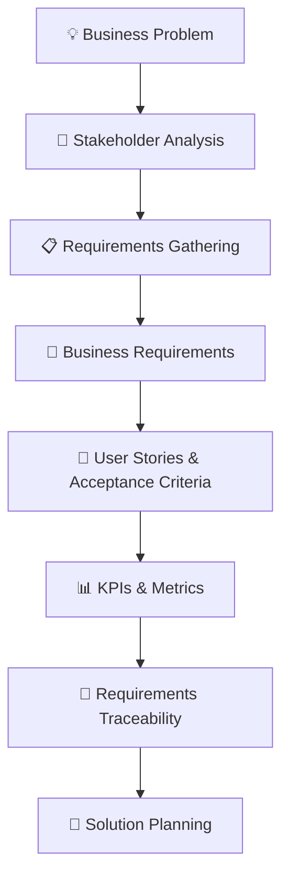

<div align="center">

# 💰 Expense & Budget Management System

### Business Analysis | Requirements Engineering | Financial Management

**Turning financial management challenges into structured business requirements and actionable insights.**

<br>


</div>

---

## 📌 Project Overview

The **Expense & Budget Management System** is a business analysis project focused on understanding how users can track expenses, manage budgets, and gain meaningful insights into their spending habits.

The project demonstrates how business needs can be translated into structured requirements and documentation that support the planning and development of a financial management solution.

Rather than focusing only on the proposed system, this project highlights the **business analysis process behind designing an effective solution**.

---

## 🎯 Business Objectives

The proposed system aims to address three key objectives:

| Objective | Description |
|---|---|
| 💳 Expense Tracking | Help users record and monitor their expenses. |
| 📊 Budget Control | Support users in managing budgets and monitoring spending. |
| 📈 Spending Insights | Provide a clearer understanding of spending patterns. |

---

## 🔍 Business Analysis Approach

The project focuses on documenting the business needs and translating them into structured deliverables.



---

## 📦 Key Project Deliverables

This repository includes the following business analysis deliverables:

### 1. 👥 Stakeholder Analysis
Identifying relevant stakeholders and understanding their roles and interests in the proposed system.

### 2. 📋 Business & Functional Requirements
Documenting business needs and defining the functional expectations of the system.

### 3. 📝 User Stories & Acceptance Criteria
Representing user needs in a structured format and defining conditions for successful implementation.

### 4. 📊 KPIs & Metrics
Identifying performance indicators that can help evaluate expense tracking, budget control, and spending insights.

### 5. 🔗 Requirements Traceability Matrix
Organizing requirements and supporting traceability throughout the project lifecycle.

---

## 🗂️ Repository Structure

```text
expense-budget-management-ba/
│
├── analysis/
│
├── datasets/
│
├── docs/
│
└── README.md
```

| Folder / File | Purpose |
|---|---|
| `analysis/` | Project analysis materials |
| `datasets/` | Dataset resources |
| `docs/` | Business analysis documentation |
| `README.md` | Project overview and documentation |

---

## 🛠️ Tools & Technologies

| Tool | Purpose |
|---|---|
| 🐙 GitHub | Project organization and version control |
| 📝 Markdown | Structured project documentation |

---

## 💡 Expected Business Value

A well-defined expense and budget management solution can help users:

- Maintain better visibility into their expenses.
- Monitor spending against planned budgets.
- Understand spending patterns.
- Make more informed financial decisions.
- Establish clearer financial management practices.

---

## 🧠 Skills Demonstrated

- Business Analysis
- Stakeholder Analysis
- Requirements Gathering
- Business Requirements Documentation
- Functional Requirements
- User Stories
- Acceptance Criteria
- KPI Identification
- Requirements Traceability
- Documentation & Version Control

---

## 🚀 Project Purpose

This project demonstrates the application of business analysis concepts to a practical financial management scenario.

It showcases the process of understanding a business problem, organizing requirements, documenting stakeholder needs, and defining measurable objectives for a proposed system.

---

## 👨‍💻 Author

**Rithesh Kadudhuri**

Business Analysis | AI & Machine Learning | Python

🔗 **GitHub:** [github.com/rithesh1825](https://github.com/rithesh1825)

---

<div align="center">

### ⭐ If you find this project useful, consider giving it a star!

**Turning business problems into structured solutions.**

</div>
